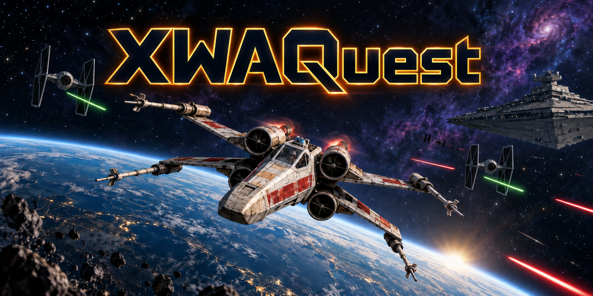

# XWAQuest

*Ilustración promocional generada con IA; no es una captura del juego.*

Adaptación experimental standalone de X-Wing Alliance para Meta Quest, basada
en OpenXWA, Android ARM64, SDL GPU/Vulkan y OpenXR. **XWAQuest es una línea
independiente de XWAWinlatorXR y PSRemoteXR.** No requiere streaming desde un PC
durante el juego. Estado revisado el **5 de octubre de 2026**.

## Estado actual

- **Logrado en pruebas anteriores:** espacio/estrellas, geometría 3D, naves,
 combate, láseres, audio y navegación del frontend. Las pruebas documentadas
 son en Quest 3S; no certifican todas las funciones de la última APK.
- **Bloqueo pendiente:** completar y validar el flujo de misiones/campaña,
 objetivos, entrega de carga, final de misión, resultados, retorno y relanzamiento.
- **SP1/SP2 implementados:** retorno de escaramuza al simulador y aborto de campaña
 al briefing de la misma misión. Las pruebas CPU y compilación no certifican
 estos recorridos completos en el visor ni la progresión o el guardado real.
- **Última APK local:** MINHUD-REFINE, `0.8.2-integrated1`, instalada y verificada
 el 2 de octubre. Sigue pendiente la certificación visual de Mission 0
 (recogida/entrega, salto, radio, objetivos y HUD). El código local contiene
 cambios posteriores al respaldo de fuentes publicado en GitHub.

## Limitaciones conocidas

Controles, interfaz y VR siguen incompletos. Se han registrado destellos/cambios
de color y parpadeo del cockpit, texto de menús inestable y limitaciones del HUD.
No se garantiza campaña completa, debriefing, progresión, rendimiento ni estabilidad.
Audio logrado en pruebas anteriores no equivale a validar toda la radio de campaña.
Seguimiento de manos/joystick virtual no se presenta como funcional; multiplayer
no está certificado. Usa un piloto de prueba separado y conserva respaldos.

XWAUP completo sigue pendiente después de preservar y validar el baseline. Una
prueba de modelo TIE modificado se bloqueó durante la carga; los experimentos de
estrellas con una textura XWAUP no demuestran compatibilidad con el mod completo.

## Requisitos y prueba mínima en Quest 3/3S

1. Quest 3 o 3S con mandos Touch, modo desarrollador y depuración USB autorizada;
  PC con Android platform-tools/ADB para instalar y preparar datos. Quest 3S es
  el visor documentado; Quest 3 es un objetivo, todavía sin validación localizada.
2. Una copia legal de X-Wing Alliance y sus datos originales. **La APK no basta:**
  los datos deben estar en el almacenamiento privado de la aplicación.
3. Si dispones de una APK local revisada, instalar sin desinstalar la anterior:
  `adb -s <serial> install -r <apk>`. Paquete integrado:
  `org.openxwa.xwaquest.m8integrated1`. No se distribuye APK en esta actualización.
4. Revisar `m8integrated1/Provision-GameData-PS51.ps1` y su worker antes de ejecutarlos.
  El worker actual copia desde `org.openxwa.xwaquest.m8test3` al paquete integrado,
  verifica hashes y rechaza un destino existente. Requiere que ese baseline ya
  tenga GameData. **No hay instalador documentado desde una instalación limpia
  de PC:** si no tienes ese baseline, falta preparar un importador desde tu copia
  legal. `GAMEDATA.md` conserva instrucciones históricas de M8, no de este paquete.
5. Abrir la app, usar un piloto de prueba y empezar por Combat Simulator y una
  escaramuza. En menús: stick derecho mueve el cursor, gatillo derecho selecciona,
  A confirma y B vuelve/pausa. En vuelo, comprobar movimiento, disparos y audio.
6. Probar B → Return to Simulator: cancelar primero y después confirmar;
  comprobar regreso y una segunda escaramuza sin reiniciar. Para campaña,
  probar por separado B → Abort Mission y regreso al briefing de la misma misión.
  Son pruebas pendientes, no resultados garantizados. Reportar visor, build,
  pasos y lo observado; no usar el piloto habitual para certificar campaña.

## APK y compilación

La APK local inspeccionada tiene **26 871 117 bytes**, ABI `arm64-v8a`, versión
`0.8.2-integrated1` / código 1 y SHA-256:

`8F74B8C8BE38796F21CBA415D7AC6E16D4E95BB244AA7C4D4F211400FABD6FDD`

No se adjunta como release: el ZIP contiene
`assets/xwaup/DefaultStarfield.dds` (25 165 952 bytes), un asset de terceros para
el que esta revisión no encontró autorización de redistribución. Además, la última
build tiene prueba visual pendiente y no es reconstruible desde este repo solo.

Para generar una candidata descargable falta:

- Preservar las fuentes locales más recientes y los cambios/dependencias externas
 de OpenXWA/Aeron, con versiones y avisos aplicables.
- Retirar o sustituir la textura XWAUP por material redistribuible, o documentar
 autorización para incluirla; comprobar que la ruta sin ella funciona.
- Preparar las bibliotecas de `m2`, `vr-probe/staging`, SDL3, OpenXR y shaders;
 usar JDK 21, Gradle 8.5, SDK 35, NDK 28.2.13676358 y CMake 3.22.1.
 En el entorno completo: `m8integrated1/Build-Target.ps1`, después
 `m8integrated1/Build-Apk.ps1`. Las instrucciones M1 de abajo no compilan M8.
- Auditar contenido y firma de la nueva APK, identificar su hash y validar en
 Quest los pasos de prueba y el aprovisionamiento antes de anunciar una release.

No se incluyen datos originales, pilotos ni mods. Este cambio actualiza la
documentación; conserva el historial y el trabajo local sin publicar código
experimental ni assets por accidente. Véase [dependencias externas](GITHUB_PREPARATION.md).

## Apoya el desarrollo / Support development

[☕ Apoyar XWAQuest mediante Mercado Pago](https://link.mercadopago.com.mx/xwaquest)

Las aportaciones son voluntarias y ayudan a cubrir herramientas de programación
e IA, pruebas y otros gastos de desarrollo. No compran el juego, sus archivos
ni contenido de terceros, y no garantizan funciones o fechas de entrega.
XWAQuest es un proyecto experimental e independiente, sin afiliación ni respaldo
oficial de los titulares del juego.

Voluntary contributions help cover programming and AI tools, testing and other
development expenses. They do not purchase the game, game assets or third-party
content, and do not guarantee features or delivery dates. XWAQuest is an
independent experimental project with no official affiliation or endorsement
from the game's rights holders.

The original M1 instructions are retained below as milestone documentation.

## XWAQuest M1

Independent Android ARM64 SDL_GPU/Vulkan/OpenXR smoke test. No OpenXWA engine or original game data is linked or packaged. Package: org.openxwa.xwaquest. hello_xr remains unchanged.

## Reproducible inputs

- SDL3: 8f8ed757bc94d2e097aab8c4c0f58b57dcee9871, local ../third_party/SDL3. CMake verifies HEAD. Override with -PsdlRoot=<absolute path>.
- SDL test/testgpu_spinning_cube_xr.c adapted into app/src/main/cpp/main.c. Upstream sources are not modified. Original notice retained; SDL-LICENSE.txt applies to the derived sample. The modifications are the XWAQuest M1 adaptation, not an upstream SDL version.
- SDL Java sources and precompiled cube SPIR-V headers come from that same checkout. No shader compiler required for this milestone.
- Gradle 8.5; Android Gradle plugin 8.1.4; JDK 21 (tested with Temurin 21.0.12.101).
- NDK 28.2.13676358; CMake 3.22.1; compile SDK 35; target 34; min 29; arm64-v8a only.
- Khronos OpenXR loader Maven artifact 1.1.43 (Apache-2.0).

Set JAVA_HOME to JDK 21 and ANDROID_HOME to the SDK, or set sdk.dir in untracked local.properties. Run:

    .\gradlew.bat :app:assembleDebug --console=plain

Output: app/build/outputs/apk/debug/app-debug.apk

The default SDL path is relative to app/. This standalone project does not link its enclosing OpenXWA checkout; it needs only the pinned SDL dependency. The local build uses a pre-existing Gradle cache and downloads missing pinned SDK/dependency packages as needed.

## Scope and visual test

A single 0.5-metre colored cube rotates approximately 2 metres in front of the initial LOCAL origin, on a dark blue background. Stereo uses separate SDL GPU render passes and XR swapchains per eye. There is no engine, game data, audio, input action set or controller mapping.

Logs use tag XWAQuest: BOOT/BUILD, XR session transitions, formats, swapchains, and FRAME every 300 successfully submitted frames. Frame submissions prove runtime acceptance, not human visual correctness.

Check that the cube is solid, colored and stereoscopic; look around gently and check that it remains in world space. Open/close the system menu and check recovery. Confirm visually before closing M1. Do not start M2 without explicit authorization.

Local diagnostic outputs are in evidence/ and are not committed. M0 backup is ../milestones/M0-20260918; it excludes original game assets and APKs containing them.
